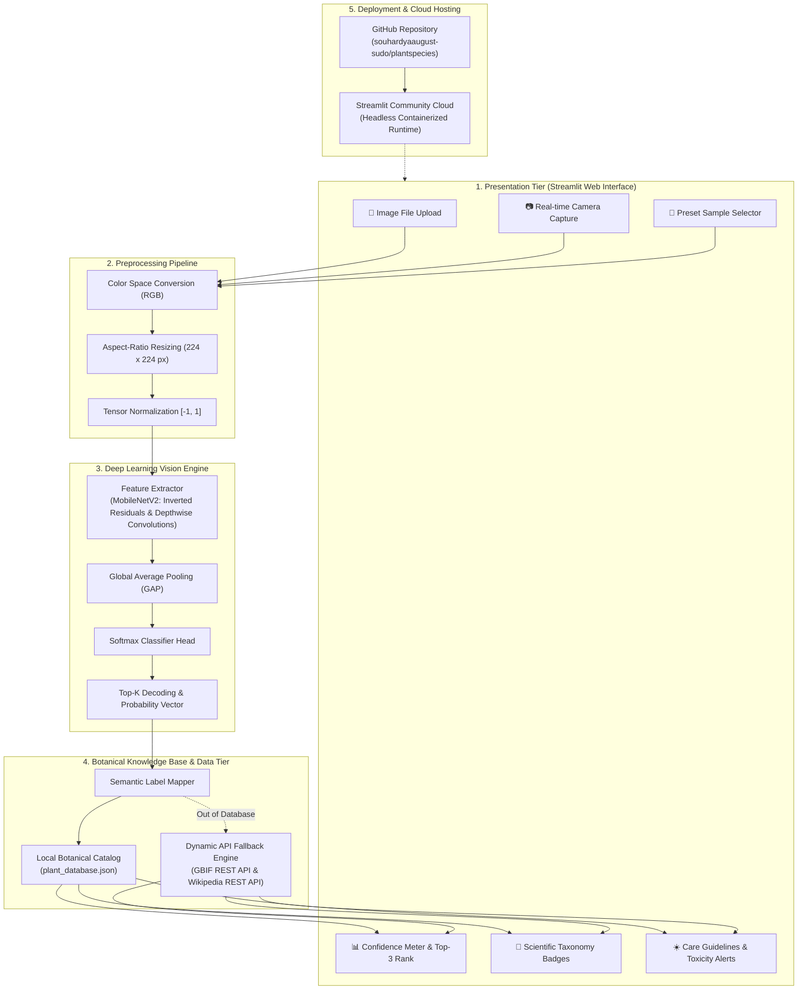

# System Architecture: Plant Species Identification & Care Guide App

## 1. High-Level System Architecture Diagram

---

## 2. Layer-by-Layer Architectural Breakdown

### Layer 1: Presentation & Interaction Tier
* **Technology**: Streamlit, Custom Botanical CSS, HTML5 Canvas.
* **Responsibilities**:
  * Provides responsive input modes: file drag-and-drop (`.jpg`, `.png`), native webcam snapshots (`st.camera_input`), and offline sample testing.
  * Renders visual outputs: match confidence progress bars, scientific binomial typography, pet safety alerts (color-coded red for toxic, green for safe), and care requirement grids.
  * Features a secondary **Botanical Encyclopedia** tab with client-side text filtering across all species.

---

### Layer 2: Preprocessing & Data Transformation Pipeline
* **Technology**: Pillow (`PIL.Image`), NumPy, TensorFlow Keras Preprocessing.
* **Workflow**:
  $$\text{Raw Image} \xrightarrow{\text{RGB Convert}} \text{Standardize Channels} \xrightarrow{\text{Bilinear Resize}} 224 \times 224 \times 3 \xrightarrow{\text{Normalize}} [-1, 1]$$
* **Why this matters**: Neural networks cannot accept variable-resolution inputs directly. Normalizing pixel values to $[-1, 1]$ prevents gradient explosion and ensures numerical stability.

---

### Layer 3: Deep Learning Vision Engine
* **Architecture**: **MobileNetV2** (Howard et al., Google Research).
* **Key Algorithmic Components**:
  1. **Depthwise Separable Convolutions**: Splits spatial filtering from channel combining, reducing parameters and computation by over **85%** compared to standard standard CNNs.
  2. **Inverted Residual Blocks**: Expands feature dimensions to a higher-dimensional space, applies depthwise filtering, then projects back down through linear bottlenecks to preserve information manifold.
  3. **Inference Performance**: Runs in $< 80\text{ ms}$ on a standard CPU, eliminating the need for expensive dedicated GPUs.

---

### Layer 4: Botanical Knowledge Base & Data Tier
* **Data Sources**: `plant_database.json`, GBIF API, Wikipedia API.
* **Schema Design**:
  * **Taxonomy**: Kingdom, Order, Family, Genus, Species.
  * **Care Profile**: Sunlight intensity, watering frequency, soil pH, temperature tolerance.
  * **Safety & Hazards**: Pet toxicity (Dogs & Cats), human culinary safety.
  * **Utility**: Medicinal, agricultural, and ecological roles.
* **Resilience Mechanism**: If a user uploads an out-of-catalog plant, the engine invokes an asynchronous fallback query to the **GBIF REST API** to retrieve live botanical taxonomy.

---

### Layer 5: Cloud Deployment & CI/CD Infrastructure
* **Version Control**: Git / GitHub (`souhardyaaugust-sudo/plantspecies`).
* **Hosting**: Streamlit Community Cloud.
* **Continuous Deployment**: Every push to the `main` branch automatically triggers a container build, resolves dependencies via `requirements.txt`, and redeploys the live web application without downtime.
